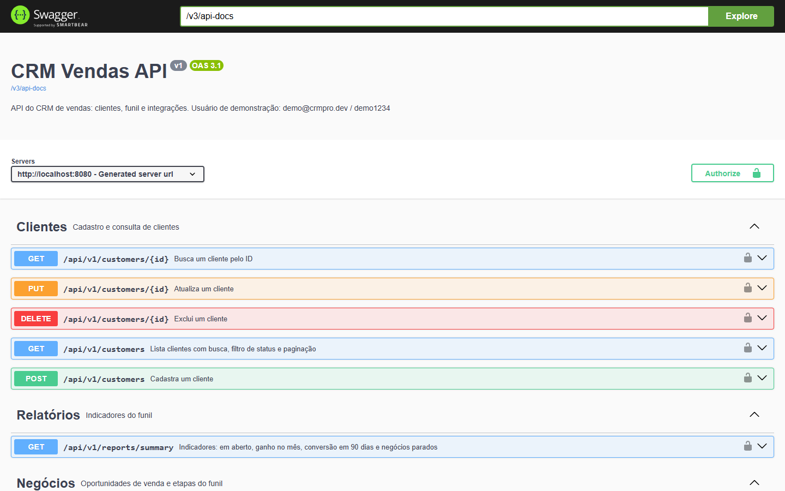

# CRM Vendas · API

[](https://github.com/jessicaccl/crm-vendas-backend/actions/workflows/ci.yml)

API REST de um CRM de vendas: clientes, funil de negócios, indicadores e integrações com outras plataformas.
Frontend em [crm-frontend](https://github.com/jessicaccl/crm-frontend).

**Demo online:** https://crm-pro-jessica.vercel.app (clique em "Entrar como demo")
**Documentação da API:** https://crm-vendas-api-a5xa.onrender.com/docs
*(plano gratuito: o primeiro acesso pode levar até 1 minuto enquanto o servidor acorda)*


**Stack:** Java 17 · Spring Boot 3.5 · Spring Security (JWT) · Spring Data JPA · PostgreSQL · Flyway · springdoc (Swagger) · Testcontainers · Docker

## Como rodar

### Opção 1: Docker (banco + API)

```bash
cp .env.example .env      # defina DB_PASSWORD e JWT_SECRET
docker compose up --build
```

API em http://localhost:8080 e documentação em http://localhost:8080/docs.

### Opção 2: PostgreSQL instalado na máquina

```bash
cp .env.example .env      # ajuste DB_URL, DB_USERNAME e DB_PASSWORD
./mvnw spring-boot:run
```

O Flyway cria e atualiza as tabelas sozinho. Com `DEMO_DATA=true`, um banco vazio recebe clientes e negócios de exemplo.

**Login de demonstração:** `demo@crmpro.dev` / `demo1234`. Para criar sua conta de administradora, defina `ADMIN_EMAIL` e `ADMIN_PASSWORD`.

### Testes

```bash
./mvnw verify
```

Roda os testes de unidade e os de integração, que sobem um PostgreSQL real com Testcontainers (precisa do Docker ligado).
No GitHub, o mesmo comando roda a cada push e pull request.

## Autenticação

A API é stateless: `POST /api/v1/auth/login` devolve um JWT, e as demais rotas exigem `Authorization: Bearer <token>`.
No Swagger, faça login, copie o `token` e clique em **Authorize**.



São públicos apenas o login, o `/actuator/health` e a documentação.

## Endpoints (v1)

| Método | Rota | O que faz |
|---|---|---|
| POST | `/api/v1/auth/login` | Login, devolve o token |
| GET | `/api/v1/auth/me` | Usuário logado |
| GET | `/api/v1/customers?q=&status=&page=&size=&sort=` | Lista clientes com busca, filtro e paginação |
| GET | `/api/v1/customers/{id}` | Detalhe |
| POST | `/api/v1/customers` | Cadastra (201 + `Location`) |
| PUT | `/api/v1/customers/{id}` | Atualiza |
| DELETE | `/api/v1/customers/{id}` | Exclui (409 se o cliente tiver negócios) |
| GET | `/api/v1/deals?q=&customerId=` | Lista negócios (alimenta o Kanban) |
| GET | `/api/v1/deals/{id}` | Detalhe |
| POST | `/api/v1/deals` | Cria um negócio |
| PUT | `/api/v1/deals/{id}` | Atualiza |
| PATCH | `/api/v1/deals/{id}/stage` | Move de etapa, grava o histórico e publica o evento |
| DELETE | `/api/v1/deals/{id}` | Exclui |
| GET | `/api/v1/reports/summary` | Indicadores: em aberto, ganho no mês, conversão em 90 dias, parados |
| POST | `/api/v1/integrations/netlify/forms` | Webhook do Netlify Forms (autenticado por assinatura) |
| GET | `/api/v1/integrations/leads` | Últimos leads recebidos por integrações |
| GET | `/api/v1/integrations/status` | Integrações ativas no ambiente |

Status do cliente: `LEAD`, `CUSTOMER`, `INACTIVE`.
Etapas do negócio: `PROSPECT`, `QUALIFIED`, `PROPOSAL`, `WON`, `LOST` (perder exige `lostReason`, senão responde 422).

Erros seguem o padrão [ProblemDetail (RFC 9457)](https://www.rfc-editor.org/rfc/rfc9457):

```json
{
  "status": 400,
  "title": "Dados inválidos",
  "detail": "Corrija os campos destacados.",
  "errors": { "name": "Informe o nome" }
}
```

## Modelo

```
Cliente 1 ── N Negócio 1 ── N Mudança de etapa
Lead recebido (integração) ──> Cliente + Negócio
Usuário (login)
```

Toda mudança de etapa gera um registro em `tb_deal_stage_changes` e publica um `DealStageChangedEvent`.
Esse evento é o ponto de extensão para integrações: na fase 5 um listener envia webhooks com ele.

## Integração: leads do formulário do Netlify

O [quiz de diagnóstico da Unic Studio](https://github.com/jessicaccl/unic-quiz-diagnostico) grava cada resposta no
Netlify Forms. Um **outgoing webhook** do Netlify envia o envio para o CRM, que:

1. **Confere a assinatura** `X-Webhook-Signature`: um JWT HS256 com `iss=netlify` e o `sha256` do corpo,
   assinado com o mesmo segredo configurado no Netlify e em `NETLIFY_WEBHOOK_SECRET`. Sem ela, responde 401.
2. **Ignora reenvios** do mesmo envio (chave única `provider + id do envio`).
3. **Encontra ou cria o contato** pelo e-mail ou pelo WhatsApp, ignorando a formatação do número,
   e completa o cadastro sem sobrescrever o que já existe.
4. **Abre um negócio** "Diagnóstico: \<resultado\>" em Prospecto, com o placar nas observações,
   passando pelo mesmo fluxo do funil (histórico de etapas e evento).
5. **Guarda o envio original** em `tb_inbound_leads` (JSONB) para auditoria.

```
Quiz (React) ─▶ Netlify Forms ─webhook assinado─▶ API ─▶ Cliente (Lead) + Negócio em Prospecto
```

Sem `NETLIFY_WEBHOOK_SECRET`, a integração fica desligada (é o caso da demo pública).

## Ambientes

O mesmo código roda em dois ambientes, separados por configuração e por banco:

| | Demo pública | CRM da Unic |
|---|---|---|
| Dados | fictícios, restaurados todo dia | reais (leads do diagnóstico) |
| Login | usuário demo aberto + administradora | só a administradora |
| Integração Netlify | desligada | ligada |
| Configuração | `DEMO_DATA=true` | `DEMO_DATA=false`, `DEMO_USER_ENABLED=false`, `NETLIFY_WEBHOOK_SECRET` |

Assim os dados de clientes reais nunca ficam visíveis para quem usa o login de demonstração (LGPD).

## Deploy

Banco no **Neon**, API no **Render** (Docker, via [`render.yaml`](render.yaml)) e frontend na **Vercel**, todos no plano gratuito.
O passo a passo com prints está em **[docs/DEPLOY.md](docs/DEPLOY.md)**.

Na demo online, `DEMO_RESET_CRON=0 0 4 * * *` restaura os dados de exemplo todo dia às 4h.

## Estrutura

```
controller/   rotas HTTP
service/      regras de negócio
repository/   acesso a dados e filtros (Specifications)
model/        entidades JPA
dto/          contratos de entrada e saída
security/     JWT, regras de acesso e respostas 401
integration/  entrada de leads externos (webhook do Netlify, assinatura, deduplicação)
exception/    erros de domínio e handler global
event/        eventos de domínio (mudança de etapa)
config/       CORS, OpenAPI, relógio/fuso, usuários iniciais, dados de demonstração
db/migration  scripts versionados do Flyway
```

## Roteiro

- [x] Fase 1: base (configuração segura, DTOs, erros padronizados, paginação, Flyway, Docker)
- [x] Fase 2: negócios, histórico de etapas e indicadores do funil
- [x] Fase 3: login (JWT), testes de integração, CI, deploy e demo online
- [x] Fase 4: integração com o formulário do Netlify e ambiente real separado da demo
- [ ] Fase 5: painel de resultados
- [ ] Fase 6: ficha do cliente com atividades e tarefas, webhooks de saída
